**Good ideas. Solid systems. Built with intent.**

   

### Hey, I'm Gowshik 👋

AI & DevOps engineer from Puducherry and the solo developer behind **[QuillPrint](https://quillprint.in)**. I build production software, AI agents and the infrastructure behind them. **AWS Certified Cloud Practitioner.**

### Featured

 
 

### Stack

Also running a self-hosted Ubuntu homelab — <a href="https://www.gowshik.in/homeserver.html">see it live ↗</a>
